<a href="https://marcinkozlowski.dev/en/"></a>

**Technical System Analyst and Full-Stack Engineer.** Seven years in banking and leasing, then testing, frontend, full-stack and systems analysis. I talk to the business in its own language and give the team requirements it can actually build from.

**[Portfolio](https://marcinkozlowski.dev/en/)** · **[Po polsku](https://marcinkozlowski.dev/)** · **[CV (PDF)](https://marcinkozlowski.dev/cv/marcin-kozlowski-en.pdf)** · **[LinkedIn](https://www.linkedin.com/in/marcinkozlowski92)** · **[Email](mailto:mar.kozlowski@protonmail.com)**

## One sentence from a meeting

> “A client can change their mind before the money leaves.”

It sounds simple. Then I ask what happens when the bank doesn’t answer, and it becomes this:

```ts
type Payout = "notSent" | "sent" | "unknown"; // a timeout is not a “no”

function withdraw(payout: Payout) {
  switch (payout) {
    case "notSent": return "cancel the contract";
    case "sent":    return "offer early settlement";
    case "unknown": return "ask the bank first"; // we don’t guess
  }
}
```

The third case is why I ask so many questions. [Follow a rule from the meeting to the code →](https://marcinkozlowski.dev/en/)

## Selected work

| | What it is | My part |
| :-- | :-- | :-- |
| **[Leasing platform](https://marcinkozlowski.dev/en/work/leasing-platform/)** <br> <sub>Concept</sub> | From application to the books, including the parts people skip | Analysis, architecture, API contracts |
| **[drpokrowiecki.com](https://marcinkozlowski.dev/en/work/drpokrowiecki/)** | A surgeon’s website that answers patients’ questions | Information architecture, design, build |
| **[squadventure.pl](https://marcinkozlowski.dev/en/work/squadventure/)** <br> <sub>In progress</sub> | A travel blog that helps you decide where to go | Product model, architecture, design, build |
| **[KajGO](https://marcinkozlowski.dev/en/work/kajgo/)** | A SaaS platform for running events | Product ownership, analysis, full-stack |
| **[Coraz Zdrowiej](https://marcinkozlowski.dev/en/work/coraz-zdrowiej/)** | A platform for patients and physiotherapists | Frontend |

## What I work with

**Analysis** &nbsp; requirements, business rules, BPMN, acceptance criteria, specifications<br>
**Design** &nbsp; domain modelling, REST, OpenAPI, integrations, real-time communication<br>
**Code** &nbsp; TypeScript, React, Next.js, React Native, Node.js, MongoDB, SQL<br>
**Delivery** &nbsp; Docker, Google Cloud, Azure DevOps, CI/CD

---

Do you have a system that needs to be understood, described or designed? **[Write to me](mailto:mar.kozlowski@protonmail.com)**, in Polish or English.
